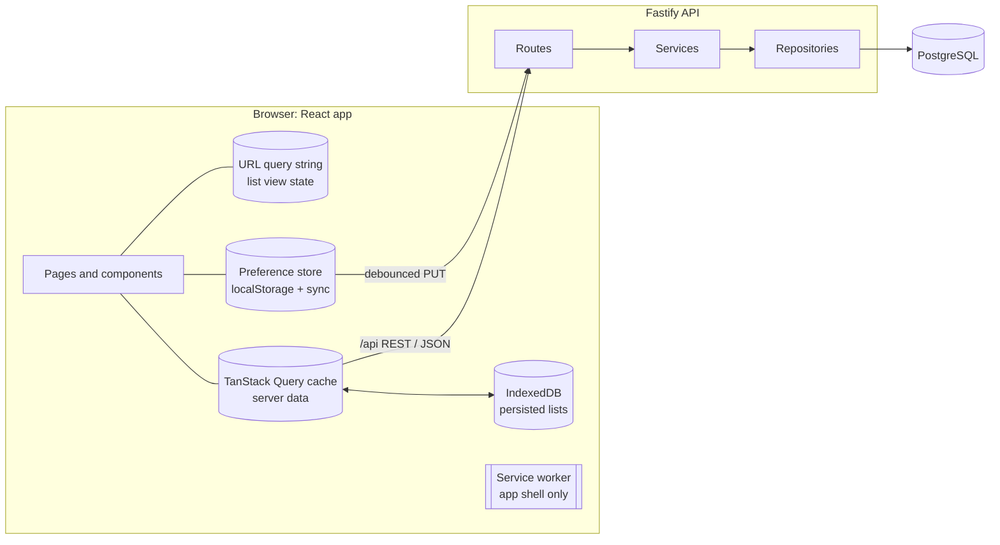
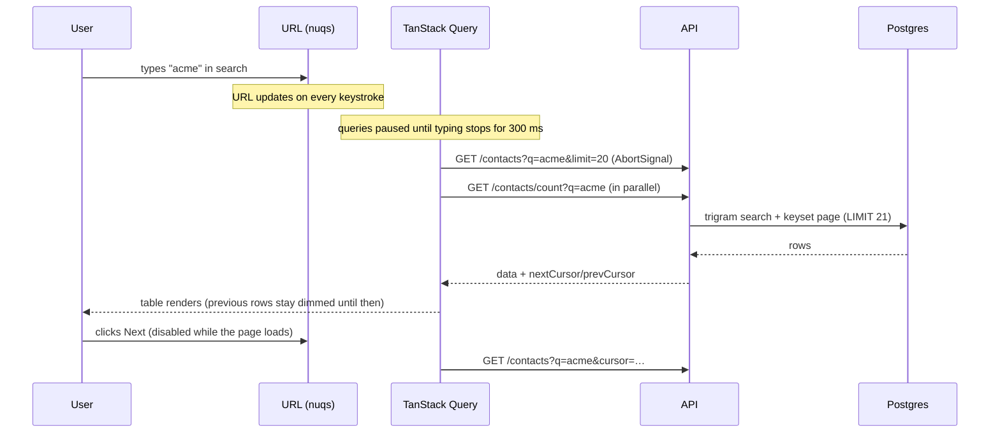
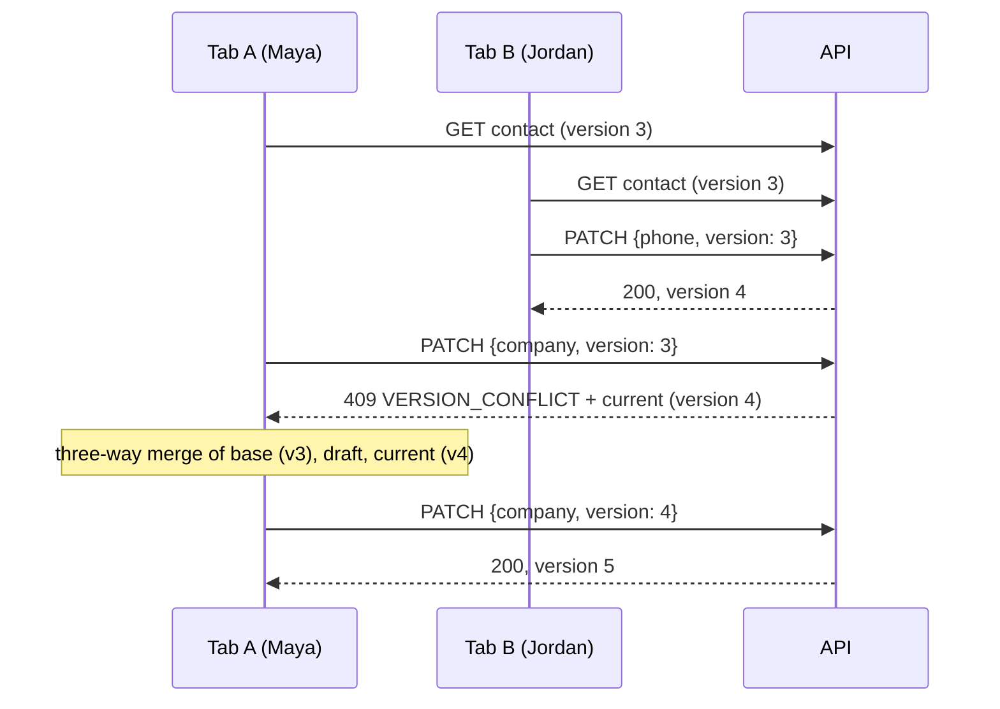
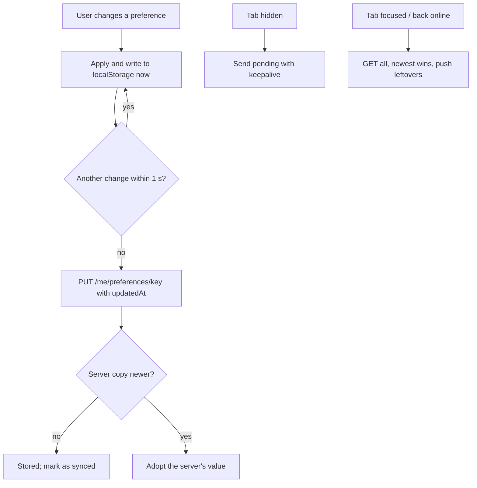
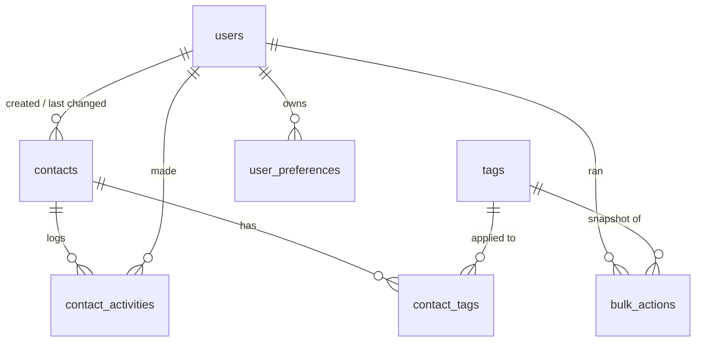

# Architecture

How the contacts workspace is put together, and why. The README has the short version; this goes
one level deeper. The frontend comes first because most of the interesting decisions are there.

## Overview



A pnpm monorepo with three packages:

| Package           | Contents                                                               |
| ----------------- | ---------------------------------------------------------------------- |
| `apps/web`        | React single-page app                                                  |
| `apps/api`        | Fastify REST API, Drizzle schema and migrations, seed and benchmark    |
| `packages/shared` | Zod schemas, request/response types and error codes used on both sides |

The shared package is why both sides agree: change a validation rule or an API shape there and
TypeScript points at every place in the API and the app that needs updating.

It's a plain SPA talking to a REST API. This is a logged-in tool, so server rendering would add
complexity without helping anyone; the built app is static files on a CDN, so it loads instantly
even while a free-tier API is waking up. The app calls `/api` on its own origin, and Vercel (or
Vite in development) forwards it, so there is no CORS.

## Frontend

```
src/
  main.tsx, App.tsx, router.tsx
  i18n/         every piece of interface text, typed (en.ts)
  lib/          http client, query client, formatting, session, cross-tab channel, lazy loading
  hooks/        debounced value, keyboard shortcuts, media queries, unsaved-changes guard
  components/   layout (shell, page header, offline banner)
                ui (button, select, multi-select, date range picker, switch, confirm dialog, modal,
                    drawer, menu, popover, toast, tooltip, sortable list, states)
  features/
    contacts/      api, list, detail, create, form, search, utils
    tags/          api, chip, picker, editor
    activity/      api, timeline
    bulk-actions/  history page
    preferences/   store, sync, hook
    settings/      app settings and dialog
    users/         teammate list and menu
    help/          keyboard shortcut reference
```

Pages lay sections out and call hooks; they don't fetch. Components get props and raise callbacks.
Logic that doesn't need React (the conflict merge, date ranges, the preference store) is plain
TypeScript with its own tests.

### Where state lives

| State                                                 | Owner             | Why                                                    |
| ----------------------------------------------------- | ----------------- | ------------------------------------------------------ |
| Search, filters, sort, page                           | URL (nuqs)        | Shareable, survives reloads, works with Back           |
| Contacts, tags, activity, counts, bulk history        | TanStack Query    | Caching, cancellation, background refresh              |
| Columns, page size, page layout, last panel, settings | Preference store  | Instant locally, synced across devices                 |
| Who you are acting as                                 | Session (per tab) | Two tabs can be two teammates                          |
| Form draft and errors                                 | React Hook Form   | Dirty tracking for the save bar and the minimal PATCH  |
| Row selection, open dialogs, drafts                   | Component state   | Belongs to one screen; selection clears on new filters |

### A list request, end to end



The search box is controlled by the URL value itself, so there is no local copy to keep in sync with
effects. Filter, sort and page-size handlers reset the page in the same update.

### Filters

Tags (any or all), created date (presets or a calendar range), and one condition per field:

| Field                     | Operators                                                      | Compared as                               |
| ------------------------- | -------------------------------------------------------------- | ----------------------------------------- |
| First name                | is, is not, contains, does not contain                         | case-insensitive text                     |
| Last name, email, company | exists, does not exist, is, is not, contains, does not contain | case-insensitive text                     |
| Phone                     | the same six                                                   | digits only, so formatting doesn't matter |

The URL and the API share one format, `email=contains:acme`, parsed and validated by the same code
in `packages/shared`. Negative conditions also match contacts with no value. The drawer works on a
draft, and Apply is disabled until something changed and every condition has a value.

### Pagination and big pages

Pages of 20 to 1,000 rows. Next and Prev carry the cursor the API returned; typing a page number
sends an offset instead. While a page loads, Next, Prev and the page box are disabled, because the
cursors on screen belong to the old page; a double click therefore moves one page (there's a test
for it).

Above 100 rows the table renders only the rows in view plus a margin (TanStack Virtual), with
spacer rows above and below so it stays a real `<table>`, and `aria-rowcount`/`aria-rowindex` so
screen readers know the full size. Up to 100 rows render normally, which keeps the browser's
find-in-page working. Phone cards are virtualized the same way, measuring each card.

### Requests and caching

- **Stale responses:** every query passes TanStack Query's `AbortSignal` to `fetch`.
- **Refetching:** previous results stay on screen, dimmed, while a refetch runs.
- **Preloading on hover** (opt-in setting): resting on a row for 150 ms loads that contact; pointing
  at Next loads the next page. Off by default because it costs requests.
- **Saving a contact** is not optimistic, because it can conflict: in-flight refetches of that
  contact are cancelled first, then the detail cache is updated and lists, counts and activity are
  invalidated.
- **Tag changes** are optimistic on the contact and in its activity list, and roll back with a toast
  if the server refuses. Changes to one contact's tags share a mutation scope, so they run in order
  and can't undo each other.
- **Bulk tagging** allows one request at a time; on success only the contacts that were sent are
  deselected.
- **Cross-tab refresh:** after any save the app posts on a `BroadcastChannel`, and other tabs refetch
  the contact. A tab that is editing it shows "updated after you opened it" straight away.

### The conflict dialog



| You changed it | They changed it        | Result                    |
| -------------- | ---------------------- | ------------------------- |
| no             | yes                    | take theirs automatically |
| yes            | no                     | keep yours automatically  |
| yes            | yes, to the same value | nothing to resolve        |
| yes            | yes, differently       | you choose, side by side  |

Field values are never swapped under the cursor. When newer data arrives, the form offers "Review
changes" (if there are edits) or "Show latest" (if there aren't). A save whose values only differ
in formatting (a phone typed another way) sends nothing and clears the edits.

### Preference sync



Synced keys: table columns (order, visibility, widths as percentages), rows per page, the contact
page layout, the last opened panel in two-column mode, and app settings (preload on hover). Other
tabs of the same browser follow through the `storage` event. Each teammate has their own copy, and
pending changes are flushed under the old teammate before switching.

### Interface rules

- One choice from a list: `Select`. Several: `MultiSelect`, a dropdown with search once the list
  is long. An ordered list: `SortableList` in a dropdown; locked items (Contact name, Activity) stay
  first, can't be dragged and can't be hidden. On/off: `Switch`. Removing something: `ConfirmDialog`,
  with focus on Cancel.
- Dialogs that edit several things keep a draft: Save is disabled until something changed, and
  Reset to default is disabled when already at the default. Settings that apply as you change them
  (the Settings dialog, column choices) have no Save button.
- A button is disabled only when pressing it would do nothing: nothing changed, a value is
  missing, or the same request is already running.

### Keyboard

| Keys                          | Action                                   |
| ----------------------------- | ---------------------------------------- |
| Ctrl/Cmd + K                  | Find a contact                           |
| Ctrl/Cmd + / or ?             | Keyboard shortcuts                       |
| `/`                           | Search the list                          |
| ↓ in search                   | Move into the results                    |
| ↑ / ↓                         | Move between rows                        |
| Enter                         | Open the contact                         |
| Space                         | Select or deselect                       |
| Shift + Space / Shift + click | Select a range                           |
| Esc                           | Clear the selection, or close the dialog |
| N                             | Add a contact                            |
| ← / →                         | Previous / next contact                  |
| Ctrl/Cmd + S                  | Save                                     |

Shortcuts never fire while typing in a field or behind an open dialog. Once anything is selected,
a click anywhere on a row (the name included) toggles it; Enter on the focused row still opens it.
Ctrl+H was considered for help but is the browser's history shortcut.

### Loading, offline and installing

- **Code splitting:** the contact page, bulk actions page, drawers and dialogs are separate chunks.
  Pointing at the button that opens one starts loading it (`lazyWithPreload`), and dialogs load
  when the browser is idle. Libraries go into long-cached vendor chunks.
- **Service worker** (`vite-plugin-pwa`): precaches the app shell, never API responses. A new deploy
  takes over and reloads the page once, so old and new code never mix. With PNG icons and a
  manifest the app can be installed ("Install app" in the user menu when the browser offers it).
- **IndexedDB:** the TanStack Query cache is persisted (`@tanstack/react-query-persist-client`,
  `idb-keyval`). Lists, counts and tags show immediately on the next visit, then refresh. Single
  contacts, activity, preferences and teammates aren't saved to disk; a new deploy discards the
  stored cache.
- **Offline:** lists stay readable, an offline banner explains why saving is unavailable, and saves
  fail at once rather than queueing.
- **First load:** table-shaped skeletons; after a few seconds, a note that the free server is waking.

### Text and languages

All interface text is in `src/i18n/en.ts`, grouped by feature, with functions for text that takes
values (`removeTagTitle(name)`). The app imports it as `t`. A second language is a file typed as
`Messages`, so TypeScript lists anything missing; picking one would be a user preference.
Validation messages come from `packages/shared` because the API returns the same ones.

### Accessibility

Real table markup with `aria-sort`; every input has a label and errors are linked to their field;
live regions announce result counts and toasts; Radix traps focus in dialogs and returns it on
close; drag-to-reorder and column resizing work from the keyboard; motion respects
`prefers-reduced-motion`. Phones get cards and a tabbed contact page, tablets two columns, wide
screens three panels.

## Backend

```
src/
  app.ts                  builds the Fastify app (used by the server and by tests)
  server.ts               reads config, connects, migrates, listens, shuts down cleanly
  config/env.ts           validated environment variables
  db/                     schema, client (Postgres or PGlite), migrations, seed, benchmark
  errors/                 AppError and the single error-to-HTTP mapper
  modules/
    contacts/             routes, service, repository, filters, cursor
    tags/                 routes, service, repository (single and bulk)
    bulk-actions/         routes, repository (the bulk history)
    activities/           routes, repository
    users/                routes, repository, current-user hook
    preferences/          routes, repository
```

Routes handle HTTP and validation. Services hold business rules: version checks, diffing, writing
activity. Repositories hold SQL. Modules without rules go straight from route to repository.

### API

All routes are under `/api/v1`. `GET /health` is liveness and never touches the database (so pings
don't keep a free database awake); `GET /health/db` is readiness and returns 503 when the database
is unreachable.

| Method and path                    | Notes                                                                      |
| ---------------------------------- | -------------------------------------------------------------------------- |
| `GET /contacts`                    | Search, filters, sort, `limit` 20–1000, and `cursor` or `offset`           |
| `GET /contacts/count`              | Same filters, exact count; requested in parallel with the page             |
| `GET /contacts/:id`                | Contact with its tags, `createdBy` and `updatedBy`                         |
| `POST /contacts`                   | Create                                                                     |
| `PATCH /contacts/:id`              | Changed fields plus `version`; 409 on a stale version or a duplicate email |
| `POST /contacts/:id/tags`          | Add a tag; idempotent                                                      |
| `DELETE /contacts/:id/tags/:tagId` | Remove a tag; idempotent                                                   |
| `POST /contacts/bulk/tags`         | Add or remove one tag for up to 1,000 contacts; logged                     |
| `GET /bulk-actions`                | Bulk history, newest first, cursor-paged                                   |
| `GET /contacts/:id/activities`     | Newest first, cursor-paged                                                 |
| `GET /tags`, `POST /tags`          | List and create tags                                                       |
| `GET /users`                       | Teammates                                                                  |
| `GET /me/preferences`              | The current teammate's saved preferences                                   |
| `PUT /me/preferences/:key`         | Save one preference (the newest write wins)                                |

Every error has the same shape, `{ "error": { "code", "message", "details" } }`, and the codes are a
shared enum, so the app reacts to `VERSION_CONFLICT` or `EMAIL_ALREADY_EXISTS` rather than parsing
messages.

| Status | When                                                                         |
| ------ | ---------------------------------------------------------------------------- |
| 200    | Successful read, update, tag change or bulk action                           |
| 201    | Contact or tag created                                                       |
| 400    | Invalid input or query (bad filter, cursor and offset together), per field   |
| 401    | Unknown teammate id in `x-user-id`                                           |
| 404    | Contact, tag or route doesn't exist                                          |
| 409    | Stale `version`, duplicate email or duplicate tag name                       |
| 500    | Unexpected error (logged with the request id, generic message to the client) |
| 503    | `/health/db` when the database is unreachable                                |

### Search and filters in SQL

Search trims and lowercases the input; if it only contains phone characters it is reduced to
digits. The query is `search_text ILIKE '%term%'`, served by the trigram index, and one index covers
name, email and phone digits.

Field conditions (`contact-filters.ts`) compare a normalised expression: `lower(first_name)`,
`lower(nullif(last_name, ''))`, `email` (stored lowercase), the phone's digits, `lower(company)`.
"Contains" on a field that is part of `search_text` adds `search_text LIKE '%v%'` as well, which is
redundant for correctness but lets Postgres use the trigram index to find candidates; company has
its own trigram index. "Is not" uses `IS DISTINCT FROM` and "does not contain" uses
`coalesce(x, '') NOT LIKE`, so contacts without a value count as not matching. User input is
escaped, so `%` and `_` match literally.

### Pagination

```sql
WHERE <filters> AND (sort_name, id) > ($value, $id)
ORDER BY sort_name, id
LIMIT $limit + 1        -- the extra row says whether there is a next page
```

- **Cursor:** opaque base64 JSON; one issued for another sort order is rejected.
- **Previous page:** flips the comparison and the order, then reverses the rows. Arriving from one
  side proves a page exists on that side; the extra row covers the other.
- **Ties:** the `id` tie-breaker keeps 300 contacts called "John Smith" in a stable order.
- **Created date:** the cursor carries the value as text at microsecond precision; a JS `Date`
  would round it and skip rows.
- **Jumping:** without a cursor the API accepts `offset` (capped at 1,000,000) and returns cursors
  as usual, so Next and Prev continue with keyset from there.

### Concurrent edits

`updateContact` runs in one transaction:

1. `SELECT … FOR UPDATE` the row; 404 if it's missing.
2. If the stored version isn't the one sent, 409 with the current contact, so the client can merge
   without another request.
3. Diff the incoming values against the row. Nothing changed: return the row as is (no version
   bump, no activity).
4. Update the changed fields, increment `version`, set `updated_by`, and insert one
   `CONTACT_UPDATED` activity with before and after values and the author.

Tag changes don't touch `version` but update `updated_at`, `updated_by` and `last_activity_at`.
Bulk tagging only inserts or deletes rows that change, writes activity only for those, and records
one `bulk_actions` row with the counts, all in the same transaction.

### Teammates and preferences

The app sends `x-user-id`; an `onRequest` hook turns it into `request.currentUser`. Without the
header reads still work and changes have no author; an unknown id gets 401, and the app forgets it
and retries once. This is attribution, not security.

Preferences are one upsert that only overwrites when the incoming timestamp is newer, and returns
what is stored afterwards, so a client whose write lost learns the winning value at once:

```sql
INSERT … ON CONFLICT (user_id, key) DO UPDATE SET value = excluded.value, updated_at = excluded.updated_at
WHERE excluded.updated_at >= user_preferences.updated_at
```

Timestamps more than five minutes in the future are rejected, so a device with a wrong clock can't
win every later write.

## Data model



```sql
CREATE UNIQUE INDEX contacts_email_unique ON contacts (email) WHERE email IS NOT NULL;
CREATE UNIQUE INDEX tags_name_unique      ON tags (lower(name));
CREATE INDEX contacts_search_trgm         ON contacts USING gin (search_text gin_trgm_ops);
CREATE INDEX contacts_company_trgm        ON contacts USING gin (lower(company) gin_trgm_ops);
CREATE INDEX contacts_company_prefix      ON contacts (lower(company) text_pattern_ops);
CREATE INDEX contacts_sort_name_id        ON contacts (sort_name, id);
CREATE INDEX contacts_created_at_id       ON contacts (created_at, id);
CREATE INDEX contact_tags_tag_contact     ON contact_tags (tag_id, contact_id);
CREATE INDEX contact_activities_contact_created
  ON contact_activities (contact_id, created_at DESC, id DESC);
CREATE INDEX bulk_actions_created_id      ON bulk_actions (created_at DESC, id DESC);
```

- **Values are stored normalised:** emails lowercased, phones E.164, names trimmed. The unique index
  and search only work if equal things look equal.
- **`sort_name` and `search_text` are generated columns,** so the database keeps them right and
  they can be indexed.
- **Tags have their own table:** they have a colour and an identity, so a join table beats an array.
- **Activity and bulk rows keep snapshots** (tag name and colour, old and new values), so renaming
  a tag doesn't rewrite history.
- **`created_by` / `updated_by` live on the contact,** backfilled from activity by the migration,
  so "last changed by" needs no extra query.

## Testing

| Layer  | Tools                                    | Focus                                                                                                           |
| ------ | ---------------------------------------- | --------------------------------------------------------------------------------------------------------------- |
| Web    | Vitest, Testing Library, MSW, happy-dom  | URL and search, states, filters, paging and jumps, selection, bulk tagging, saving, conflict merge, preferences |
| API    | Vitest, `app.inject()`, in-memory PGlite | Concurrency, uniqueness, every filter operator, paging with ties, offset jumps, authors, bulk log, preferences  |
| Shared | Vitest                                   | Normalisation, validation messages, the condition format                                                        |

API tests run the real migrations against an in-memory Postgres, so the SQL under test is the SQL
that ships. The web tests use happy-dom rather than jsdom because Node's `fetch` rejects jsdom's
`AbortSignal`. Async assertions wait for the UI rather than sleeping. One test used to be flaky:
it read the URL right after the new page rendered, but nuqs writes the URL on a short throttle, so
it now waits for the URL like everything else.

## Scale

See the README's "Scale considerations" for measured numbers and what changes with millions of
contacts, heavy write traffic, frequent search and many users.
