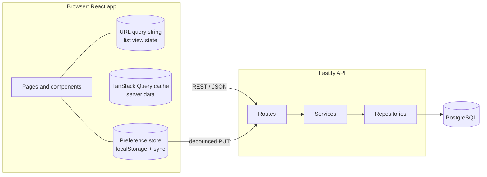
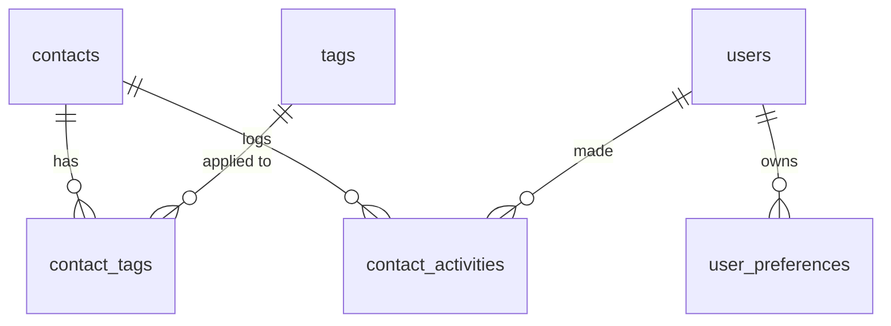

# Architecture

How the contacts workspace is put together, and why. The README has the short version; this file
goes one level deeper.

## Overview



It's a pnpm monorepo with three packages:

| Package           | Contents                                                               |
| ----------------- | ---------------------------------------------------------------------- |
| `apps/api`        | Fastify REST API, Drizzle schema and migrations, seed script           |
| `apps/web`        | React single-page app                                                  |
| `packages/shared` | Zod schemas, request/response types and error codes used on both sides |

The shared package is the reason both sides agree. If a validation rule or an API shape changes
there, TypeScript points at every place in the API and the app that needs updating.

I chose a plain SPA talking to a REST API. This is a logged-in tool, so server rendering would add
complexity without helping anyone. The built app is static files on a CDN, so it loads instantly even
while a free-tier API is waking up.

## Data model



```sql
CREATE UNIQUE INDEX contacts_email_unique ON contacts (email) WHERE email IS NOT NULL;
CREATE UNIQUE INDEX tags_name_unique      ON tags (lower(name));
CREATE INDEX contacts_search_trgm         ON contacts USING gin (search_text gin_trgm_ops);
CREATE INDEX contacts_sort_name_id        ON contacts (sort_name, id);
CREATE INDEX contacts_created_at_id       ON contacts (created_at, id);
CREATE INDEX contacts_company_prefix      ON contacts (lower(company) text_pattern_ops);
CREATE INDEX contact_tags_tag_contact     ON contact_tags (tag_id, contact_id);
CREATE INDEX contact_activities_contact_created
  ON contact_activities (contact_id, created_at DESC, id DESC);
```

A few choices worth explaining:

- **Values are stored normalised.** Emails are lowercased, phones are E.164, names are trimmed. The
  unique index and search only work if equal things look equal.
- **`sort_name` and `search_text` are generated columns.** The database keeps them correct, and
  they can be indexed. `search_text` holds the phone's digits only, which is what makes phone
  search ignore formatting.
- **Tags have their own table.** They have a colour and an identity, so a join table beats an
  array column. "Contacts with tag X" is an index range scan.
- **Activity rows keep a snapshot.** For example, the tag's name and colour at the time, or the
  field's old and new value. A renamed tag doesn't rewrite history.
- **`last_activity_at` lives on the contact.** It powers the "Last activity" column without a join
  per row, and is updated in the same transaction as each activity insert.

## Backend

```
src/
  app.ts                  builds the Fastify app (used by the server and by tests)
  server.ts               reads config, connects, migrates, listens, shuts down cleanly
  config/env.ts           validated environment variables
  db/                     schema, client (Postgres or PGlite), migrations, seed
  errors/                 AppError and the single error-to-HTTP mapper
  modules/
    contacts/             routes, service, repository, filters, cursor
    tags/                 routes, service, repository (single and bulk)
    activities/           routes, repository
    users/                routes, repository, current-user hook
    preferences/          routes, repository
```

Routes deal with HTTP and validation. Services hold business rules: version checks, diffing, writing
activity. Repositories hold SQL. Modules with no rules (activities, users, preferences) go straight
from route to repository.

### API

All routes are under `/api/v1`. `GET /health` sits at the root for the host's health check.

| Method and path                    | Notes                                                                      |
| ---------------------------------- | -------------------------------------------------------------------------- |
| `GET /contacts`                    | Search, filters, sort, `limit` 20/50/100 and `cursor`                      |
| `GET /contacts/count`              | Same filters, exact count; requested in parallel with the page             |
| `GET /contacts/:id`                | Contact with its tags                                                      |
| `POST /contacts`                   | Create                                                                     |
| `PATCH /contacts/:id`              | Changed fields plus `version`; 409 on a stale version or a duplicate email |
| `POST /contacts/:id/tags`          | Add a tag; idempotent                                                      |
| `DELETE /contacts/:id/tags/:tagId` | Remove a tag; idempotent                                                   |
| `POST /contacts/bulk/tags`         | Add or remove one tag for up to 500 contacts                               |
| `GET /contacts/:id/activities`     | Newest first, cursor-paged                                                 |
| `GET /tags`, `POST /tags`          | List and create tags                                                       |
| `GET /users`                       | Teammates                                                                  |
| `GET /me/preferences`              | The current teammate's saved preferences                                   |
| `PUT /me/preferences/:key`         | Save one preference (the newest write wins)                                |

Every error has the same shape, `{ "error": { "code", "message", "details" } }`, and the codes are a
shared enum, so the app reacts to `VERSION_CONFLICT` or `EMAIL_ALREADY_EXISTS` rather than parsing
messages. One handler maps errors to responses:

| Status | When                                                                         |
| ------ | ---------------------------------------------------------------------------- |
| 200    | Successful read, update, tag change or bulk action                           |
| 201    | Contact or tag created                                                       |
| 400    | Invalid input or query parameters, with per-field messages                   |
| 401    | Unknown teammate id in `x-user-id`                                           |
| 404    | Contact, tag or route doesn't exist                                          |
| 409    | Stale `version`, duplicate email or duplicate tag name                       |
| 500    | Unexpected error (logged with the request id, generic message to the client) |
| 503    | `/health` when the database is unreachable                                   |

### Search

The input is trimmed and lowercased. If it only contains phone characters (digits, spaces, `+ - ( )
.`), it is reduced to digits. The query is `search_text ILIKE '%term%'`, which the trigram index can
serve, and one index covers name, email and phone.

### Pagination

Each page is fetched with a keyset cursor:

```sql
WHERE <filters> AND (sort_name, id) > ($value, $id)
ORDER BY sort_name, id
LIMIT $limit + 1        -- the extra row tells us whether there is a next page
```

- **Cursor format:** an opaque base64 string. A cursor issued for one sort order is rejected for
  another.
- **Previous page:** flips the comparison and the order, then reverses the rows.
- **Ties:** the `id` tie-breaker means 300 contacts called "John Smith" still page correctly.
- **Created date:** cursors carry the value at full microsecond precision; rounding it to a JS
  `Date` would skip rows.

### Concurrent edits

`updateContact` runs in one transaction:

1. `SELECT … FOR UPDATE` the row. If it's missing, return 404.
2. If the stored version isn't the one the client sent, return 409 with the current contact, so
   the client can merge without another request.
3. Diff the incoming values against the row. If nothing actually changed, return the row as it is
   (no version bump, no activity).
4. Update the changed fields, increment `version`, and insert one `CONTACT_UPDATED` activity with
   the before and after values and the author.

Tag changes don't touch `version` (see the README for why), but they do update `updated_at` and
`last_activity_at`. Bulk tagging only inserts or deletes rows that actually change, and only those
get activity entries, so running it twice is harmless.

### Teammates and preferences

There is no login. The app sends `x-user-id`, and an `onRequest` hook turns it into
`request.currentUser`:

- **No header:** reads still work, and changes are recorded without an author.
- **Unknown id:** 401. The app then forgets that id and retries the request once without it.

This is attribution, not security, and the README says so. Seeded teammates have fixed ids, so a
browser that picked one keeps working after the database is reseeded.

Preferences are stored per teammate and key. The write is a single upsert that only overwrites when
the incoming timestamp is newer:

```sql
INSERT … ON CONFLICT (user_id, key) DO UPDATE SET value = excluded.value, updated_at = excluded.updated_at
WHERE excluded.updated_at >= user_preferences.updated_at
```

The response is whatever is stored afterwards, so a client whose write lost learns the winning
value immediately.

## Frontend

```
src/
  main.tsx, App.tsx, router.tsx
  lib/          http client, query client, formatting, session, cross-tab channel
  hooks/        debounced value, keyboard shortcuts, media queries, unsaved-changes guard
  components/   layout (shell, page header, offline banner) and ui (buttons, fields, modal, drawer,
                menu, popover, toast, sortable list, states)
  features/
    contacts/   api, list, detail, create, form, search, utils
    tags/       api, chip, picker, editor
    activity/   api, timeline
    preferences/ store, sync, hook
    users/      teammate list and menu
    help/       keyboard shortcut reference
```

Pages lay sections out and call hooks; they don't fetch. Components get props and raise callbacks.
Logic that doesn't need React, such as the merge, cursor helpers and date ranges, is plain
functions with their own tests.

### Where state lives

| State                                 | Owner             | Why                                                   |
| ------------------------------------- | ----------------- | ----------------------------------------------------- |
| Search, filters, sort, page           | URL (nuqs)        | Shareable, survives reloads, works with Back          |
| Contacts, tags, activity, counts      | TanStack Query    | Caching, cancellation, background refresh             |
| Column layout, page size, page layout | Preference store  | Instant locally, synced across devices                |
| Who you are acting as                 | Session (per tab) | Two tabs can be two teammates                         |
| Form draft and errors                 | React Hook Form   | Dirty tracking for the save bar and the minimal PATCH |
| Row selection                         | Component state   | Cleared when the filters change                       |

The search box is controlled by the URL value itself, so there is no local copy to keep in sync.
The only effect involved is the 300 ms debounce timer that decides when to send the request. While
the user is still typing, the list and count queries are paused and keep showing the previous
results. Filter, sort and page-size handlers reset the cursor in the same update, so the list always
goes back to page 1.

### Requests and caching

- **Stale responses:** every query passes TanStack Query's `AbortSignal` to `fetch`, so an
  out-of-date response can't overwrite a newer one.
- **Refetching:** previous results stay on screen, dimmed, while a refetch runs.
- **Prefetching:** happens on intent. Hovering "Next" fetches the next page; hovering a row fetches
  that contact.
- **Saving a contact** is not optimistic, because it can conflict:
  - in-flight refetches of that contact are cancelled first, so an older response can't land after
    the save;
  - on success the detail cache is updated and lists, counts and activity are invalidated.
- **Tag changes** are optimistic and roll back with a toast if the server refuses.
- **Cross-tab refresh:** after any save the app posts a message on a `BroadcastChannel`, and other
  open tabs refetch the affected contact. If one of those tabs is editing it, the "updated after you
  opened it" notice appears straight away, before that user presses Save.

### The conflict dialog

The form remembers the version it was opened from (`base`). When a save returns 409, the dialog
runs a three-way merge of `base`, the draft and the server's current copy:

| You changed it | They changed it        | Result                    |
| -------------- | ---------------------- | ------------------------- |
| no             | yes                    | take theirs automatically |
| yes            | no                     | keep yours automatically  |
| yes            | yes, to the same value | nothing to resolve        |
| yes            | yes, differently       | you choose, side by side  |

"Save merged version" re-submits against the new version. If that is also stale, the dialog
appears again with fresh choices.

Field values are never swapped under the user's cursor. When newer data arrives, the form offers
"Review changes" (if there are edits) or "Show latest" (if there aren't).

### Preference sync

The store keeps each preference with the time it was changed and a `pending` flag.

- **Change:** apply it and write to localStorage immediately, then send one `PUT` a second after the
  last change. Dragging a column edge produces one request, not hundreds.
- **On load and whenever the tab regains focus:**
  - fetch the server's copy;
  - the newer value wins;
  - local changes that never reached the server are pushed.
- **When the tab is hidden:** pending changes are sent with `fetch(…, { keepalive: true })`, so they
  survive closing the tab.
- **Coming back online:** pending changes are retried.
- **Other tabs in the same browser:** they follow along through the `storage` event.

Column widths are percentages of the table, not pixels. Dragging an edge moves width between the two
neighbouring columns, so the total stays at 100% and the table never overflows. The resize handles
also work from the keyboard (left and right arrows).

### Offline and loading

- **Service worker:** precaches the app shell (`vite-plugin-pwa`), so repeat visits start instantly
  and the app opens without a connection. It never caches API responses. When a new version is
  deployed, the new worker takes over and the page reloads once, so old and new code never mix.
- **IndexedDB:** the TanStack Query cache is persisted with `@tanstack/react-query-persist-client`
  and `idb-keyval`.
  - Lists, counts and tags you've seen show immediately on the next visit, then refresh as normal.
  - Single contacts and activity are not persisted, so an edit always starts from the server's
    current version.
  - Saves are never queued: offline, they fail at once with a clear message.
  - Offline, they stay readable, and an offline banner explains why saving is unavailable.
  - Preferences and the teammate list are left out too, and a new deploy discards the stored cache.
- **First load:** shows table-shaped skeletons. If the API takes more than a few seconds (a sleeping
  free-tier server), a message says it's waking up.

### Accessibility

- **Markup:**
  - real table markup with `aria-sort`;
  - every input has a label, and errors are linked to their field;
  - live regions announce result counts and toasts.
- **Dialogs and drawers:** Radix traps focus inside them and gives it back when they close.
- **Keyboard:**

  | Keys         | Action                                   |
  | ------------ | ---------------------------------------- |
  | `/`          | Focus search                             |
  | ↓ in search  | Move into the results                    |
  | ↑ / ↓        | Move between rows                        |
  | Space        | Select or deselect the row               |
  | Enter        | Open the contact                         |
  | Esc          | Clear the selection, or close the dialog |
  | N            | Add a contact                            |
  | Ctrl/Cmd + K | Quick find                               |
  | ← / →        | Previous / next contact                  |
  | Ctrl/Cmd + S | Save                                     |
  | ?            | Shortcut list                            |

  Page shortcuts are ignored while typing in a field or while a dialog is open. Once something is
  selected, clicking a row toggles it instead of opening it; the name link still opens the contact.

- **Layout by screen size:**
  - phones get cards instead of a table and a tabbed contact page;
  - tablets get two columns;
  - wide screens get three panels.
- **Motion:** respects `prefers-reduced-motion`.

## Testing

| Layer  | Tools                                    | Focus                                                                                                 |
| ------ | ---------------------------------------- | ----------------------------------------------------------------------------------------------------- |
| API    | Vitest, `app.inject()`, in-memory PGlite | Concurrency, uniqueness, activity and authors, bulk counts, search, paging with ties, preference sync |
| Web    | Vitest, Testing Library, MSW, happy-dom  | URL and search behaviour, states and recovery, bulk tagging, saving, validation, conflict merge       |
| Shared | Vitest                                   | Normalisation and validation messages                                                                 |

API tests run the real migrations against an in-memory Postgres, so the SQL under test is the SQL
that ships. The web tests use happy-dom rather than jsdom because React Router and TanStack Query
pass an `AbortSignal` to `fetch`, and Node's `fetch` rejects jsdom's signal objects.

## Scale

See the README's "Scale" section for what changes with millions of contacts and heavy traffic. In
short, this design holds up because every query has an index and paging cost doesn't grow with
depth. The next steps would be account-level partitioning, a dedicated search engine fed by
change-data-capture, maintained counters, background jobs for bulk work, and server-pushed change
events.
